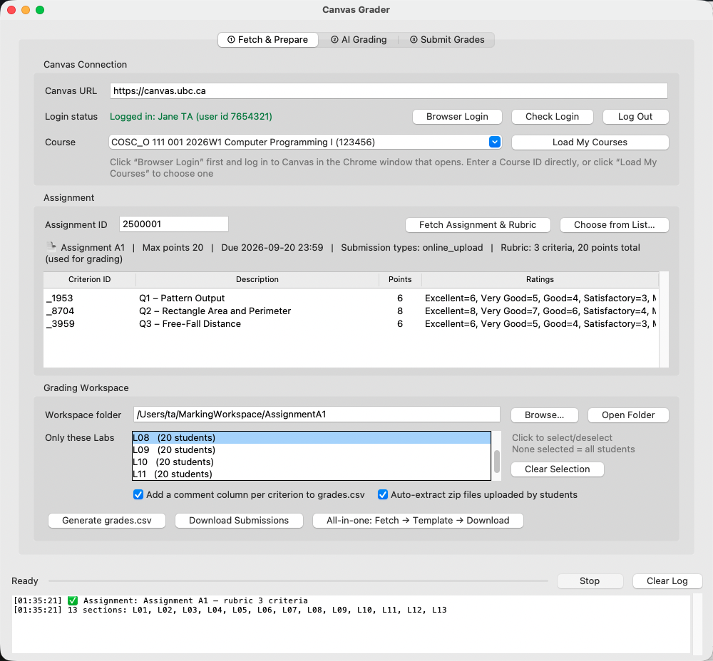
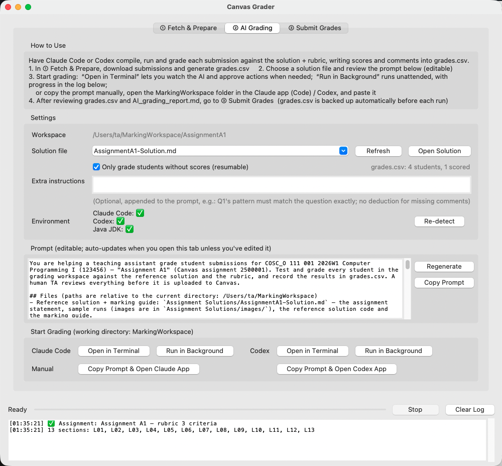
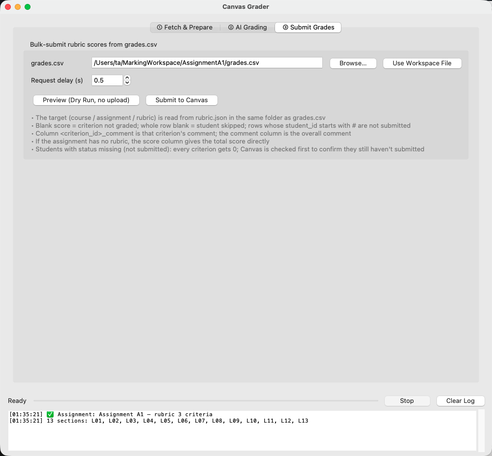

# Canvas Grader Quick Start

> [中文](QuickStart_zh.md) · [한국어](QuickStart_ko.md)

Grade one assignment with Canvas Grader: **download the submissions → grade them (with AI or by hand) → upload the rubric scores to Canvas in one click**. This guide covers only the everyday workflow.

---

## 0. Install (once per computer)

| System | How |
|---|---|
| macOS | In Terminal, run `bash install.sh` |
| Windows | Double-click `install.bat` |

The installer sets up Python and asks whether to install the tools used for AI grading: Java JDK, Claude Code and Codex. Answer `y` if you want AI grading.
When it finishes, double-click the **`Canvas Grader (English)`** launcher in the folder to start the app.

> The login needs Google Chrome (on Windows, Microsoft Edge also works).

---

## 1. Log in and download submissions — “① Fetch & Prepare”



1. Click **“Browser Login”** and sign in with CWL / Duo in the Chrome window that opens. The window closes by itself and the app shows a green “Logged in”.
2. Click **“Load My Courses”** and pick your course in the **Course** drop-down.
3. Enter the **Assignment ID** (the number after `…/assignments/` in the assignment's Canvas URL), or use **“Choose from List…”**, then click **“Fetch Assignment & Rubric”**. The rubric criteria appear in the table.
4. Under **“Only these Labs”**, click the lab(s) you mark (e.g. L08). Nothing selected = all students.
5. Click **“All-in-one: Fetch → Template → Download”**.

Your workspace folder (named after the assignment, e.g. `AssignmentA1/`) now contains:

```
AssignmentA1/
  grades.csv      ← grade sheet (one row per student)
  rubric.json     ← rubric definition (used when uploading)
  manifest.csv    ← submission list (submitted time, late or not)
  L08/
    Doe_Jane_1000/ ← one folder per student; zip files already extracted
```

> Students who did not submit are already given **0** on every criterion in grades.csv.

**Quizzes, text entries and other non-file submissions** download too (use the quiz's assignment ID):

| Submission type | What the student folder contains |
|---|---|
| Classic Quiz / New Quizzes | `quiz_answers.html` (open in a browser: questions, answers, points, lateness) and `quiz_answers.md`; earlier attempts are `quiz_attempt<N>.*`; files from file-upload questions are in `quiz_files/` |
| Text entry | `submission_text.html` (pasted images saved in `submission_text_files/`) and `submission_text.txt` |
| URL / media recording / discussion | `submission_link.url` / `media_recording.mp4` etc. / `discussion_posts.html` |
| Annotation assignments, other external tools (LTI) | a note + `SpeedGrader.url` (this content can only be viewed in SpeedGrader) |

For quizzes the workspace also gets `quiz_questions.md` (questions + answer key) and `quiz_responses.csv` (every student's answers side by side, one column per question — handy for grading one question across the class). Every student folder has a `SpeedGrader.url` that opens that student in SpeedGrader.

---

## 2. Grade

### Option A: AI grading — “② AI Grading”



> **Prompt version / solution folder**: “Prompt version” offers *COSC 111 · Java programming* and *COSC 329 · Learning Analytics* (it tells Reading reflections — graded leniently — from Module Quizzes — graded precisely — and Python assignments, and writes `feedback_for_instructor.md` with the common mistakes). “Solution folder” can be any folder (e.g. `COSC 329 - Bowen/section6`); each prompt version remembers its own folder. Choosing `(whole folder)` as the solution file hands the whole folder to the AI. “Custom templates…” opens `Prompt Templates/`, where you can add your own templates with placeholders such as `{{assignment_name}}` (see the README.md there).

1. Check that **“Solution file”** points to this assignment's solution. Solutions live in the `Assignment Solutions/` folder and are matched by assignment number automatically.
2. Optionally add this assignment's deduction rules under **“Extra instructions”**. The prompt below is generated automatically and can be edited directly.
3. Click **“Open in Terminal”** next to Claude Code (or Codex). A terminal opens and grading starts right away. You can watch the AI compile, run and score each student, and approve its actions when asked.
   - The first time you use Claude Code, log in inside the terminal (type `/login`).
   - If you don't want to watch, click **“Run in Background”**. Progress then appears in the log at the bottom of the window.
4. When the AI finishes, scores and comments are in `grades.csv` and its reasoning is in `AI_grading_report.md`. **Always check the students marked NEEDS REVIEW in the report.**

> grades.csv is backed up automatically before every run (`grades_backup_beforeAI_<time>.csv`). The AI never changes student files and never uploads anything to Canvas.

### Option B: Grade by hand

Open `grades.csv` in Excel or any spreadsheet app:

| Column | What to enter |
|---|---|
| Each criterion ID column | The score for that criterion. Row 2 (`#rubric`) shows which criterion each column is and its maximum. |
| `<ID>_comment` | A comment for that criterion (optional) |
| `comment` | An overall comment for the student (optional) |

An empty score means that criterion is not graded; a completely empty row skips the student. Keep the file in CSV format when saving.

---

## 3. Upload scores — “③ Submit Grades”



1. Click **“Use Workspace File”** to select the grades.csv from step 1.
2. Click **“Preview (Dry Run, no upload)”** first and check every student's scores in the log.
3. When everything looks right, click **“Submit to Canvas”**. The scores appear as rubric assessments in SpeedGrader.

---

## FAQ

- **“Session expired”** → click “Browser Login” again.
- **A student resubmitted after you downloaded** → click “Download Submissions” again. Only changed submissions are downloaded, and the old version is kept as a `…_attempt1` folder.
- **A “missing” student submitted later** → before uploading, the app checks Canvas. Students who have since submitted are not given 0, and the log tells you to grade them.
- **grades.csv looks garbled in Excel** → use Data → From Text/CSV and choose UTF-8.
