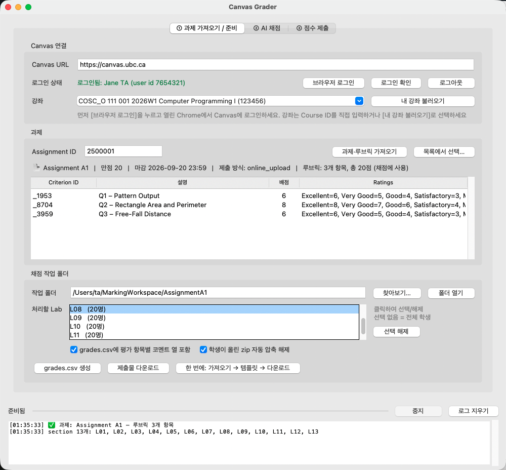
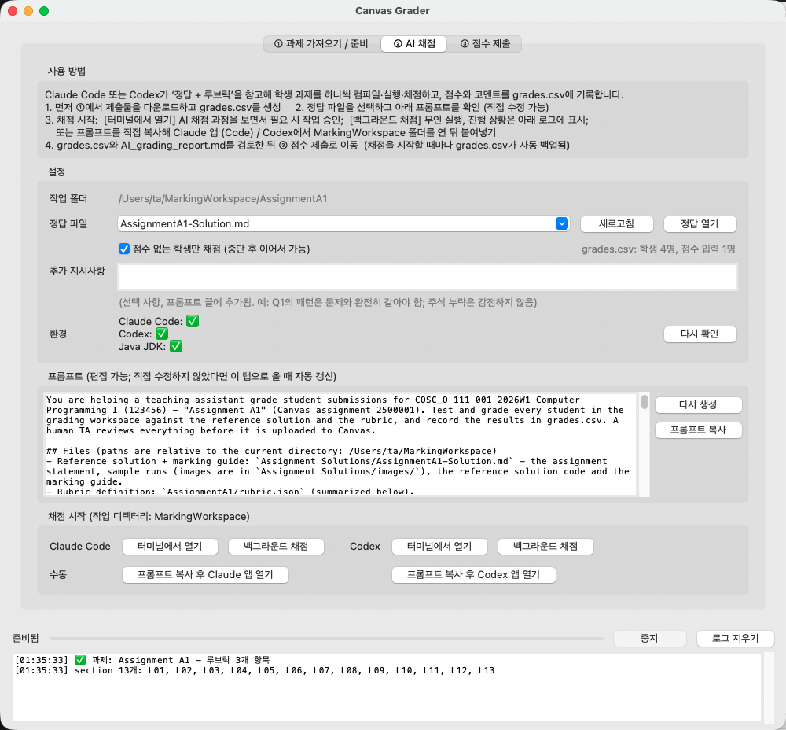
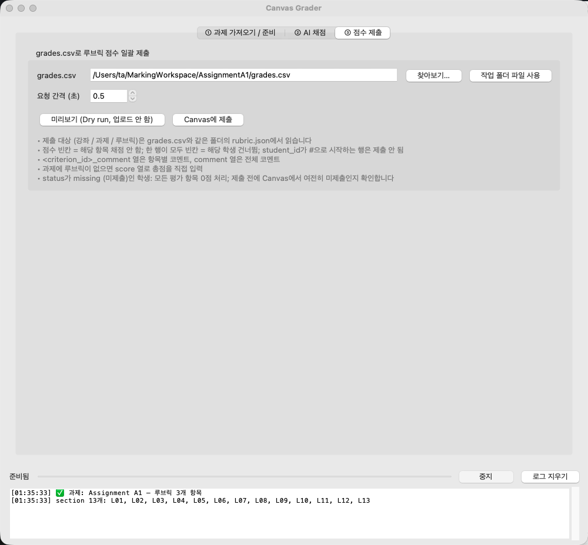

# Canvas Grader 빠른 채점 가이드

> [中文](QuickStart_zh.md) · [English](QuickStart_en.md)

Canvas Grader로 과제 하나를 채점하는 흐름입니다: **학생 제출물 다운로드 → 채점 (AI 또는 직접) → 루브릭 점수를 Canvas에 한 번에 업로드**. 이 가이드는 가장 자주 쓰는 과정만 다룹니다.

---

## 0. 설치 (컴퓨터마다 한 번만)

| 운영체제 | 방법 |
|---|---|
| macOS | 터미널에서 `bash install.sh` 실행 |
| Windows | `install.bat` 더블클릭 |

설치 스크립트가 Python 환경을 준비하고, AI 채점에 쓰는 Java JDK, Claude Code, Codex를 설치할지 물어봅니다. AI 채점을 쓰려면 `y`를 입력하세요.
설치가 끝나면 폴더 안의 **`Canvas Grader (한국어)`** 실행 파일을 더블클릭해 프로그램을 여세요.

> 로그인에는 Google Chrome이 필요합니다 (Windows에서는 Edge도 가능).

---

## 1. 로그인하고 제출물 다운로드 — [① 과제 가져오기 / 준비]



1. **[브라우저 로그인]**을 누르고, 열린 Chrome 창에서 CWL / Duo 로그인을 마치세요. 로그인되면 창이 자동으로 닫히고 초록색 "로그인됨"이 표시됩니다.
2. **[내 강좌 불러오기]**를 누르고 "강좌" 목록에서 담당 강좌를 고르세요.
3. **Assignment ID**에 과제 번호를 입력하거나 **[목록에서 선택…]**을 누른 뒤 **[과제·루브릭 가져오기]**를 누르세요. 과제 번호는 Canvas 과제 주소에서 `…/assignments/` 뒤의 숫자입니다. 표에 루브릭 평가 항목이 표시됩니다.
4. **[처리할 Lab]**에서 담당 Lab(예: L08)을 클릭해 선택하세요. 아무것도 선택하지 않으면 전체 학생이 대상입니다.
5. **[한 번에: 가져오기 → 템플릿 → 다운로드]**를 누르세요.

작업 폴더(과제 이름을 따름, 예: `AssignmentA1/`)에 다음 파일이 생깁니다:

```
AssignmentA1/
  grades.csv      ← 채점표 (학생당 한 행)
  rubric.json     ← 루브릭 정의 (점수 제출 시 사용)
  manifest.csv    ← 제출 목록 (제출 시각, 지각 여부)
  L08/
    Doe_Jane_1000/ ← 학생별 폴더, zip은 자동으로 압축 해제됨
```

> 과제를 제출하지 않은 학생은 grades.csv에 이미 모든 항목 **0점**으로 기록되어 있습니다.

**퀴즈, 텍스트 등 파일이 아닌 제출물**도 다운로드됩니다 (퀴즈의 Assignment ID를 입력):

| 제출 방식 | 학생 폴더에 생기는 파일 |
|---|---|
| Classic Quiz / New Quizzes | `quiz_answers.html` (브라우저로 열기: 문제, 답안, 점수, 지각 여부)와 `quiz_answers.md`; 이전 attempt는 `quiz_attempt<N>.*`; 파일 업로드 문제의 파일은 `quiz_files/` |
| 텍스트 (Text Entry) | `submission_text.html` (붙여 넣은 이미지는 `submission_text_files/`)와 `submission_text.txt` |
| URL / 음성·영상 녹화 / 토론 | `submission_link.url` / `media_recording.mp4` 등 / `discussion_posts.html` |
| 주석 과제, 기타 외부 도구 (LTI) | 안내 파일 + `SpeedGrader.url` (이 내용은 SpeedGrader에서만 볼 수 있음) |

퀴즈는 작업 폴더에 `quiz_questions.md` (문제 + 정답)와 `quiz_responses.csv` (전체 학생 답안을 나란히, 문제마다 한 열 — 한 문제를 전체 학생에 대해 채점할 때 편리)도 만듭니다. 모든 학생 폴더에 해당 학생의 SpeedGrader를 여는 `SpeedGrader.url`이 있습니다.

---

## 2. 채점

### 방법 A: AI 채점 — [② AI 채점]



> **프롬프트 버전 / 정답 폴더**: [프롬프트 버전]에서 *COSC 111 · Java 프로그래밍 과제* 또는 *COSC 329 · Learning Analytics*를 고를 수 있습니다 (Reading은 관대하게, Quiz는 엄격하게, Python 과제는 실행 검사로 자동 구분하고, 강사에게 보낼 공통 오류 요약 `feedback_for_instructor.md`도 작성). [정답 폴더]는 아무 폴더나 선택할 수 있으며 (예: `COSC 329 - Bowen/section6`), 프롬프트 버전마다 각자의 폴더를 기억합니다. 정답 파일에서 `(폴더 전체)`를 고르면 폴더 전체를 AI에 넘깁니다. [사용자 템플릿…]을 누르면 `Prompt Templates/` 폴더가 열리며, `{{assignment_name}}` 같은 자리표시자를 쓰는 템플릿을 직접 추가할 수 있습니다 (폴더 안 README.md 참고).

1. **"정답 파일"**이 이번 과제의 정답인지 확인하세요. 정답은 `Assignment Solutions/` 폴더에 있으며 과제 번호로 자동 매칭됩니다.
2. 필요하면 **"추가 지시사항"**에 이번 과제의 감점 기준을 적으세요. 아래 프롬프트는 자동으로 생성되며 직접 수정할 수도 있습니다.
3. Claude Code(또는 Codex) 옆의 **[터미널에서 열기]**를 누르세요. 터미널이 열리고 바로 채점이 시작됩니다. AI가 학생마다 컴파일·실행·채점하는 과정을 지켜보면서, 요청하면 작업을 승인하면 됩니다.
   - Claude Code를 처음 쓸 때는 터미널에서 로그인하세요 (`/login` 입력).
   - 지켜보지 않아도 된다면 **[백그라운드 채점]**을 누르세요. 진행 상황은 창 아래쪽 로그에 표시됩니다.
4. AI가 끝나면 점수와 코멘트는 `grades.csv`에, 채점 근거는 `AI_grading_report.md`에 기록됩니다. **보고서에서 NEEDS REVIEW로 표시된 학생은 꼭 직접 확인하세요.**

> 채점을 시작할 때마다 grades.csv가 자동으로 백업됩니다 (`grades_backup_beforeAI_<시각>.csv`). AI는 학생 파일을 수정하지 않으며 Canvas에 직접 제출하지도 않습니다.

### 방법 B: 직접 채점

Excel 등 스프레드시트 프로그램으로 `grades.csv`를 여세요:

| 열 | 입력할 내용 |
|---|---|
| 각 평가 항목 ID 열 | 해당 항목 점수 (2행 `#rubric`에 각 열이 어떤 항목이고 만점이 몇 점인지 적혀 있음) |
| `<ID>_comment` | 해당 항목 코멘트 (선택) |
| `comment` | 학생에게 줄 전체 코멘트 (선택) |

점수를 비워 두면 그 항목은 채점하지 않고, 한 행이 모두 비어 있으면 그 학생은 건너뜁니다. 저장할 때 CSV 형식을 유지하세요.

---

## 3. 점수 업로드 — [③ 점수 제출]



1. **[작업 폴더 파일 사용]**을 눌러 1단계의 grades.csv를 선택하세요.
2. 먼저 **[미리보기 (Dry run, 업로드 안 함)]**을 눌러 로그에서 학생별 점수를 확인하세요.
3. 문제가 없으면 **[Canvas에 제출]**을 누르세요. 점수가 SpeedGrader에 루브릭 평가로 표시됩니다.

---

## 자주 묻는 질문

- **"로그인이 만료되었습니다"** → [브라우저 로그인]을 다시 누르세요.
- **다운로드 후에 학생이 다시 제출했어요** → [제출물 다운로드]를 한 번 더 누르세요. 바뀐 제출물만 다시 받고, 이전 버전은 `…_attempt1` 폴더로 남겨 둡니다.
- **미제출 학생이 나중에 제출했어요** → 점수를 제출하기 전에 프로그램이 Canvas에서 다시 확인합니다. 이미 제출한 학생은 0점 처리되지 않고, 로그에서 채점하라고 알려 줍니다.
- **Excel에서 grades.csv 글자가 깨져요** → "데이터 → 텍스트/CSV에서" 가져오기로 열고 인코딩을 UTF-8로 선택하세요.
