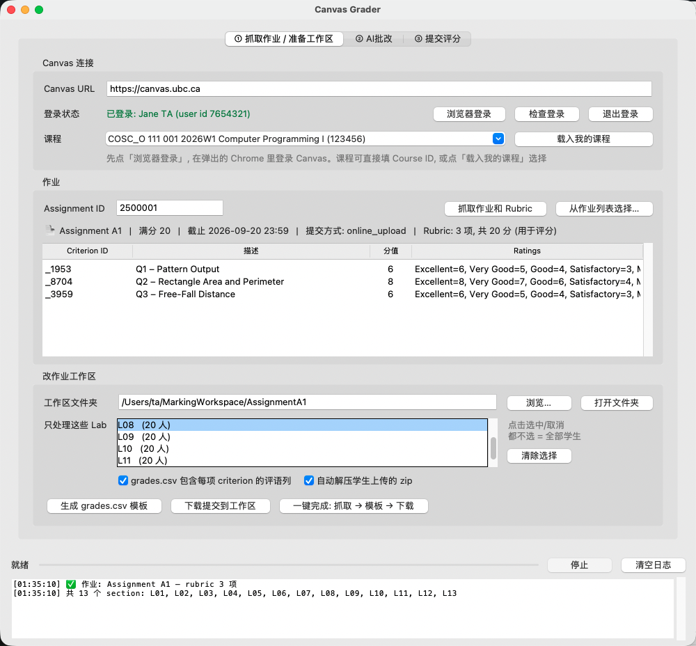
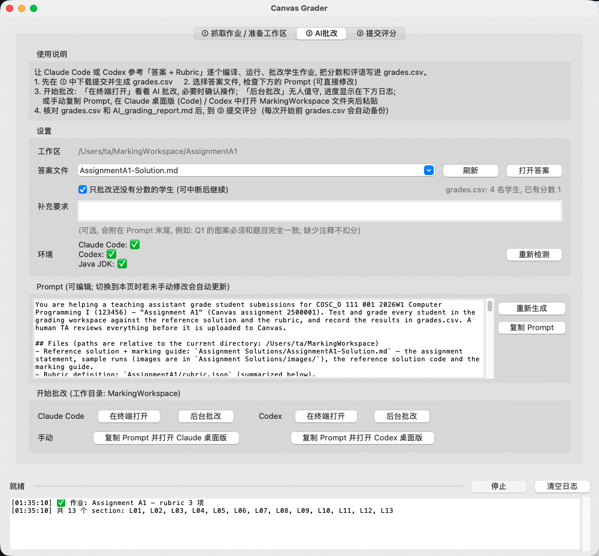
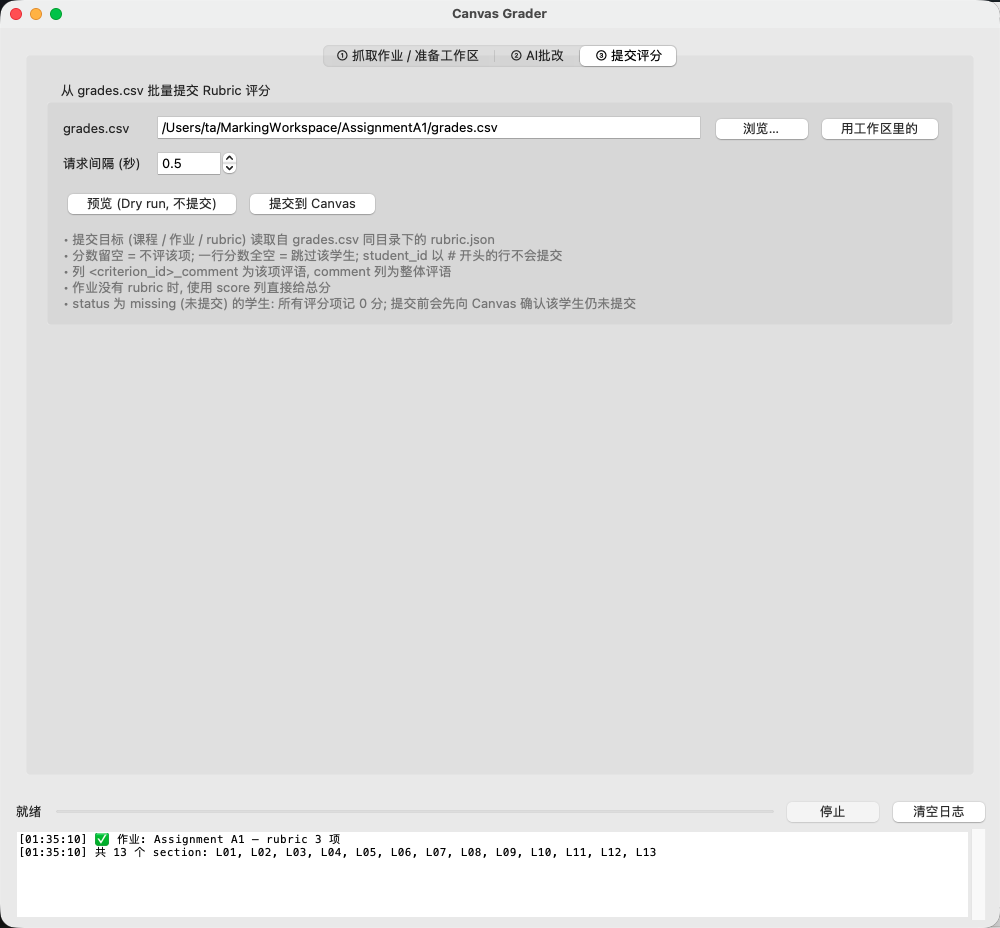

# Canvas Grader 快速改作业指南

> [English](QuickStart_en.md) · [한국어](QuickStart_ko.md)

用 Canvas Grader 完成一次作业批改：**下载学生提交 → 批改 (AI 或手动) → 一键把 Rubric 分数上传到 Canvas**。本指南只介绍最常用的流程。

---

## 0. 安装 (每台电脑只需一次)

| 系统 | 做法 |
|---|---|
| macOS | 在终端运行 `bash install.sh` |
| Windows | 双击 `install.bat` |

安装脚本会准备 Python 环境，并询问是否安装 AI 批改用到的 Java JDK、Claude Code、Codex (想用 AI 批改就选 `y`)。
完成后，双击文件夹里的 **`Canvas Grader (中文)`** 启动器打开程序。

> 登录需要 Google Chrome (Windows 上也可以用 Edge)。

---

## 1. 登录并下载学生提交 — 「① 抓取作业 / 准备工作区」



1. 点 **「浏览器登录」**，在弹出的 Chrome 窗口里完成 CWL / Duo 登录。登录成功后窗口自动关闭，界面显示绿色的「已登录」。
2. 点 **「载入我的课程」**，在「课程」下拉框选择本课程。
3. 在 **Assignment ID** 填作业编号 (Canvas 作业网址 `…/assignments/` 后面的数字)，或点 **「从作业列表选择…」**，然后点 **「抓取作业和 Rubric」**。表格里会列出 Rubric 的各个评分项。
4. 在 **「只处理这些 Lab」** 里点选你负责的 Lab (例如 L08)。都不选 = 全部学生。
5. 点 **「一键完成: 抓取 → 模板 → 下载」**。

完成后，工作区文件夹 (默认以作业名命名，例如 `AssignmentA1/`) 里会有：

```
AssignmentA1/
  grades.csv      ← 评分表 (每个学生一行)
  rubric.json     ← Rubric 定义 (提交评分时使用)
  manifest.csv    ← 提交清单 (提交时间、是否迟交)
  L08/
    Doe_Jane_1000/ ← 每个学生一个文件夹, zip 已自动解压
```

> 未提交作业的学生，在 grades.csv 里已自动记为 **0 分**。

**Quiz、文字和其它非文件提交**也能下载 (Assignment ID 填 quiz 对应的作业编号即可)：

| 提交方式 | 学生文件夹里会有 |
|---|---|
| Classic Quiz / New Quizzes | `quiz_answers.html` (浏览器打开，含题目、答案、得分、是否迟交) 和 `quiz_answers.md`；以前的 attempt 为 `quiz_attempt<N>.*`；文件上传题的文件在 `quiz_files/` |
| 文字 (Text Entry) | `submission_text.html` (贴进去的图片保存在 `submission_text_files/`) 和 `submission_text.txt` |
| 网址 / 录音录像 / 讨论 | `submission_link.url` / `media_recording.mp4` 等 / `discussion_posts.html` |
| 批注作业、其它外部工具 (LTI) | 说明文件 + `SpeedGrader.url` (这些内容只能在 SpeedGrader 里看) |

Quiz 还会在工作区生成 `quiz_questions.md` (题目 + 正确答案) 和 `quiz_responses.csv` (全班答案并排，每题一列，适合"挑 2 题给所有人批")。每个学生文件夹里都有 `SpeedGrader.url`，双击直接打开该学生的 SpeedGrader。

---

## 2. 批改

### 方式 A：AI 批改 — 「② AI批改」



> **Prompt 版本 / 答案目录**：「Prompt 版本」可选 *COSC 111 · Java 编程作业* 或 *COSC 329 · Learning Analytics* (自动区分 Reading 宽松批改、Quiz 严格批改、Python 作业运行检查，并生成给老师的常见错误反馈 `feedback_for_instructor.md`)。「答案目录」可以选任意文件夹 (例如 `COSC 329 - Bowen/section6`)，每个 Prompt 版本会各自记住自己的答案目录；「答案文件」选 `(整个目录)` 会把整个文件夹交给 AI。点「自定义模板…」可以在 `Prompt Templates/` 里放自己的模板 (支持 `{{assignment_name}}` 等占位符，见其中的 README.md)。

1. 确认 **「答案文件」** 选中了本次作业的答案 (放在 `Assignment Solutions/` 文件夹里，会按作业编号自动匹配)。
2. 需要的话在 **「补充要求」** 里写本次的扣分细则。下方的 Prompt 会自动生成，也可以直接修改。
3. 点 Claude Code 的 **「在终端打开」** (或 Codex 的)。终端会打开并自动开始批改，你可以看着 AI 逐个编译、运行、评分，必要时确认它的操作。
   - 第一次使用 Claude Code 需要在终端里登录 (输入 `/login`)。
   - 不想盯着看，可以点 **「后台批改」**，进度显示在窗口下方的日志里。
4. AI 完成后，分数和评语写进 `grades.csv`，批改依据写在 `AI_grading_report.md`。**请重点核对报告里标记为 NEEDS REVIEW 的学生。**

> 每次开始前 grades.csv 都会自动备份 (`grades_backup_beforeAI_<时间>.csv`)。AI 不会修改学生文件，也不会自己提交到 Canvas。

### 方式 B：手动批改

用 Excel 或任何表格软件打开 `grades.csv`：

| 列 | 填什么 |
|---|---|
| 每个 criterion 的 ID 列 | 该项分数 (第 2 行 `#rubric` 写着每一列对应哪一项、满分多少) |
| `<ID>_comment` | 该项的评语 (可选) |
| `comment` | 给学生的整体评语 (可选) |

分数留空 = 不评该项；一整行都空 = 跳过该学生。保存时保持 CSV 格式。

---

## 3. 上传分数 — 「③ 提交评分」



1. 点 **「用工作区里的」** 选中刚才的 grades.csv。
2. 选 **「提交模式」**。一般用「自动」：测验 (New Quizzes / Classic Quiz) 的 grades.csv 有 Q1, Q2, … 逐题分数列时，会打开浏览器在 SpeedGrader 里逐题给分（Classic Quiz 的逐题评语写进该题下面的 Additional Comments），其他情况用 API 提交总分 / Rubric 评分。
3. 先点 **「预览 (Dry run, 不提交)」**，在日志里核对每个学生的分数。
4. 确认无误后点 **「提交到 Canvas」**。分数会作为 Rubric 评分出现在 SpeedGrader 里。

---

## 常见问题

- **提示登录已过期** → 重新点「浏览器登录」。
- **学生在你下载之后又重新提交了** → 再点一次「下载提交到工作区」。只会下载有变化的学生，旧版本会保留为 `…_attempt1` 文件夹。
- **未提交的学生后来补交了** → 提交评分时程序会先向 Canvas 确认，已经补交的学生不会被记 0 分，日志里会提醒你去批改。
- **Excel 打开 grades.csv 乱码** → 用「数据 → 从文本/CSV 导入」，编码选 UTF-8。
